# 历史地图地名提取平台

这是一个运行在 Windows 电脑上的历史地图地名提取桌面平台。用户导入历史地图后，平台会进行图像预处理、滑动窗口检测和文字识别，再把地名框、识别文本和置信度显示在地图上。

平台支持三种本地推理方式：

- NVIDIA 显卡：CUDA GPU 推理，速度最快。
- 普通 CPU：OpenVINO 推理，适合没有 NVIDIA 显卡的电脑。
- CPU TorchScript：兼容性回退方案，速度较慢。

平台运行时不需要 WSL，也不需要网络服务。网络只用于第一次下载代码、依赖和模型。

---

## 一、部署到本地电脑

### 1. 准备软件

建议使用以下环境：

- Windows 10/11，64 位。
- Python 3.10，64 位。
- Git。
- 至少 8 GB 内存；处理大幅历史地图时建议 16 GB 以上。
- 如果使用 GPU，需要安装 NVIDIA 驱动。

Python 可以从 [Python 官网](https://www.python.org/downloads/windows/) 下载。安装时请勾选 **Add Python to PATH**。

### 2. 克隆代码

在 PowerShell 中执行：

```powershell
git clone https://github.com/EveningFreeze/historical_map.git
cd historical_map
```

模型文件不放在普通 Git 历史中，而是作为 GitHub Release 资源分发。首次部署时执行下面的命令，脚本会把模型下载到仓库的 `models\` 目录，并校验文件大小和 SHA256：

```powershell
.\scripts\download_models.ps1 -Backend all
```

模型目录下载完成后至少应包含：

```text
models\
├─ recognizer_cuda.ts       # CUDA GPU 模式
├─ recognizer.ts            # TorchScript CPU 模式
├─ recognizer.onnx          # OpenVINO CPU 模式
└─ tw25_cls_list.txt        # 繁体中文字符词表
```

模型文件名不能随意修改，否则平台无法找到对应模型。

### 3. 判断是否有 NVIDIA 独立显卡

在 PowerShell 中执行：

```powershell
nvidia-smi
```

如果能看到 NVIDIA 显卡型号、驱动版本和显存信息，可以安装 GPU 版 PyTorch。如果提示找不到 `nvidia-smi`，或者电脑只有 Intel/AMD 集成显卡，建议选择 CPU 版本。

也可以在 Windows“任务管理器 → 性能 → GPU”中查看显卡型号。

### 4. 安装 GPU 环境

有 NVIDIA 显卡时，在项目根目录执行：

```powershell
powershell -ExecutionPolicy Bypass -File .\scripts\setup_windows_gpu.ps1
```

安装脚本会创建：

```text
historical_map_platform\.venv_gpu\
```

所有 GPU 依赖都会安装到这个目录，包括 GPU 版 PyTorch、PyQt5、OpenCV、NumPy、Shapely 和 OpenVINO，不会安装到系统 Python 或 WSL 中。

安装完成后验证 CUDA：

```powershell
& .\.venv_gpu\Scripts\python.exe -c "import torch; print(torch.__version__); print(torch.version.cuda); print(torch.cuda.is_available()); print(torch.cuda.get_device_name(0) if torch.cuda.is_available() else 'GPU不可用')"
```

正常情况下应看到类似结果：

```text
2.5.1+cu124
12.4
True
NVIDIA GeForce RTX 4060 Laptop GPU
```

#### GPU 安装速度很慢时

CUDA 版 PyTorch 安装包较大。如果自动安装失败，可以先创建环境，再手动安装：

```powershell
cd historical_map_platform
python -m venv .venv_gpu

New-Item -ItemType Directory -Force .\_tmp_gpu | Out-Null
$env:TEMP = (Resolve-Path .\_tmp_gpu).Path
$env:TMP = $env:TEMP

& .\.venv_gpu\Scripts\python.exe -m pip install -r .\requirements.txt
& .\.venv_gpu\Scripts\python.exe -m pip install openvino==2025.1.0
& .\.venv_gpu\Scripts\python.exe -m pip install torch==2.5.1+cu124 `
  --index-url https://download.pytorch.org/whl/cu124 `
  --extra-index-url https://pypi.tuna.tsinghua.edu.cn/simple `
  --no-cache-dir --timeout 120 --retries 3
```

CUDA 专用 PyTorch 必须从 PyTorch 官方 CUDA 源下载；清华源只用于普通依赖。

### 5. 安装 CPU 环境

没有 NVIDIA 显卡时执行：

```powershell
powershell -ExecutionPolicy Bypass -File .\scripts\setup_windows_cpu.ps1
```

安装脚本会创建：

```text
historical_map_platform\.venv_cpu\
```

CPU 依赖、pip 缓存和临时文件都放在项目所在磁盘，不要求使用 WSL。CPU 环境包含 OpenVINO 和 TorchScript 两种后端。

### 6. 启动平台

推荐使用自动启动器：

```powershell
.\run_platform.ps1
```

启动器会按以下顺序寻找环境：

1. `.venv_gpu`，且其中确实安装了 PyTorch。
2. `.venv_cpu`。
3. 其他项目虚拟环境。
4. 系统 Python。

因此，GPU 电脑通常会自动进入 GPU 环境；没有 GPU 的电脑会进入 CPU 环境。启动器不会自动查找用户电脑中任意位置的 PyTorch。如果 PyTorch 安装在自定义目录，需要先激活该环境，再执行：

```powershell
python .\run.py
```

### 7. 创建桌面快捷方式

```powershell
powershell -ExecutionPolicy Bypass -File .\scripts\create_desktop_shortcut.ps1
```

快捷方式名称为“历史地图识别平台”。如果存在打包好的 exe，快捷方式会优先启动 exe；否则会启动 `run_platform.ps1`，自动选择 GPU 或 CPU 环境。

---

## 二、平台使用说明

### 1. 导入历史地图

点击“导入历史地图”，选择 JPG、PNG、TIFF、BMP 或 WEBP 文件。导入后，中间地图区域会显示原图，左侧会显示当前文件路径。

建议先确认地图方向、图像完整性、文字清晰度和空白区域，再开始识别。

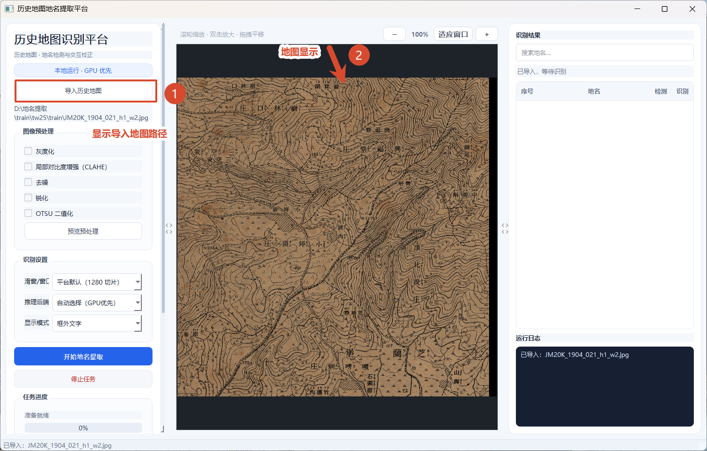

### 2. 图像预处理

| 选项 | 功能 | 可能影响 |
|---|---|---|
| 灰度化 | 去掉颜色信息，只保留明暗关系 | 减少颜色干扰，但可能损失彩色文字信息 |
| 局部对比度增强（CLAHE） | 增强局部文字边缘 | 适合文字偏淡的地图；过强会放大纹理噪声 |
| 去噪 | 减少纸张纹理和扫描噪声 | 过强会损失细小笔画 |
| 锐化 | 加强文字边缘和笔画 | 过度锐化可能产生伪边缘 |
| OTSU 二值化 | 将图像转换为黑白前景和背景 | 适合黑白对比明显的地图，彩色地图需谨慎 |

点击“预览预处理”后可以观察效果。预处理不是越多越好，建议一次只选一种或两种方式比较。

> **【灰度化效果展示】**
>
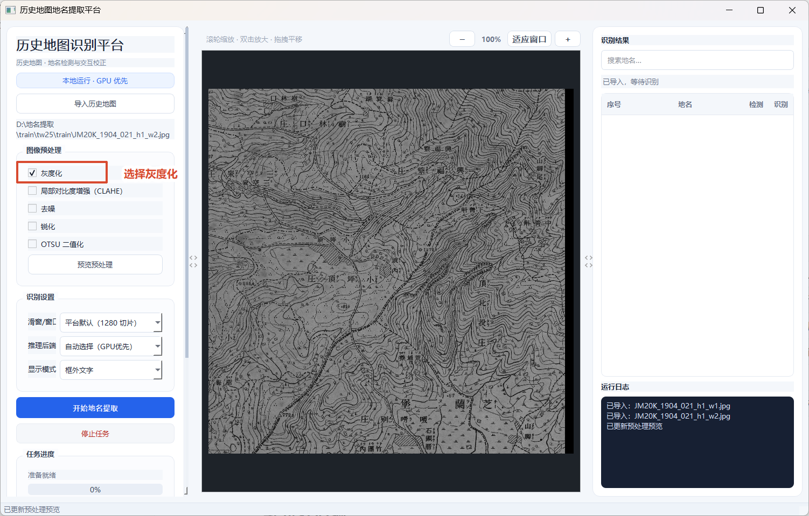
>
> **【局部对比度增强效果展示】**
>
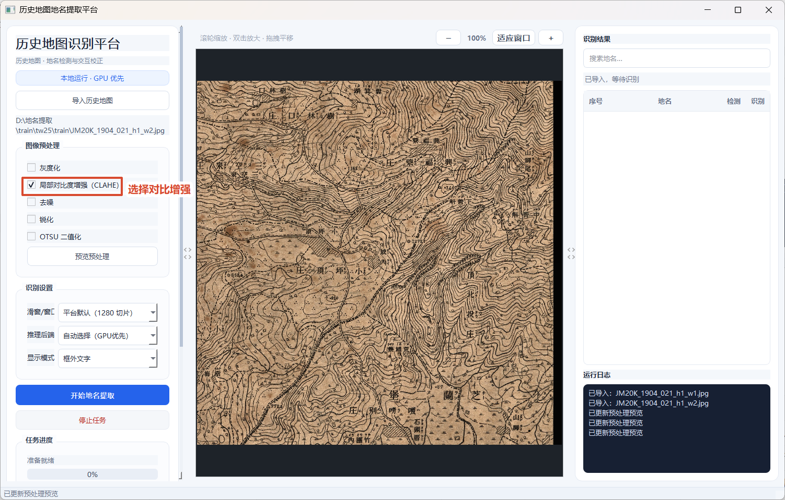
>
> 【去噪效果展示】
>
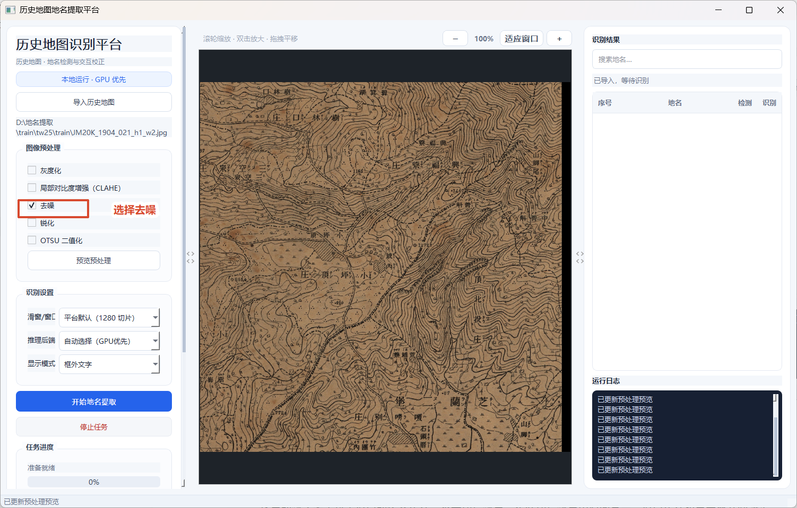
>
> 【锐化效果展示】
>
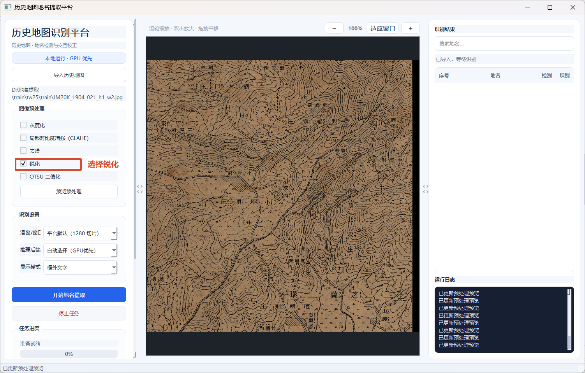
>
> 【二值化效果展示】
>
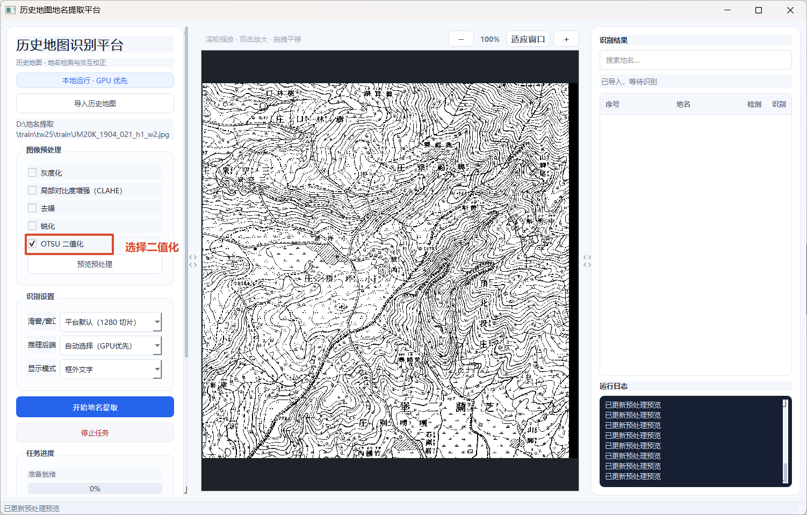

### 3. 滑窗/窗口尺寸

这里的数字表示每个窗口的像素尺寸，不是切片数量。实际切片数量由原图宽高、窗口尺寸和重叠率共同决定。

| 模式 | 窗口尺寸 | 效果 | 适用情况 |
|---|---:|---|---|
| 平台默认（1280 切片） | 1280×1280 | 速度和效果平衡 | 推荐作为正式识别起点 |
| 高召回（1280 低阈值） | 1280×1280 | 保留更多低分候选框 | 漏检较多时尝试，但误检可能增加 |
| 高召回（1280+1600 双尺度） | 1280+1600 | 两轮推理，进一步补检 | 重点追求召回率，速度较慢 |
| 快速（2048 像素窗口） | 2048×2048 | 窗口更大，通常切片更少 | 快速预览，小文字可能漏检 |
| 标准（1536 像素窗口） | 1536×1536 | 速度和细节居中 | 普通大图处理 |
| 精细（1024 像素窗口） | 1024×1024 | 窗口更小，通常切片更多 | 小字较多、需要精细检查的地图 |

重叠区域可以减少文字被切到边界后的漏检，但重叠越大，推理次数越多。例如日志中的 `1/6` 表示当前这一轮共有 6 个窗口，不表示窗口尺寸是 6，也不表示有 2048 个切片。双尺度模式还会继续显示“1600 补检”进度。

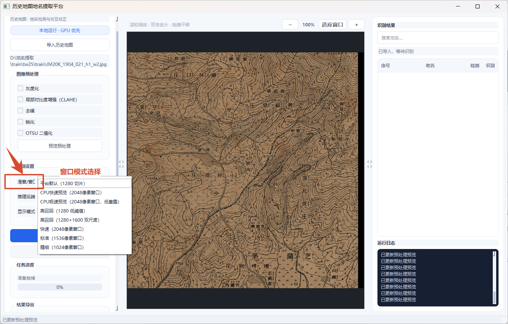

### 4. 推理后端

| 选项 | 使用什么 | 速度 | 适用情况 |
|---|---|---|---|
| 自动选择（GPU 优先） | 有 CUDA 就用 GPU，否则回退 OpenVINO | 通常最快 | 普通用户推荐 |
| Windows GPU（CUDA） | NVIDIA GPU + CUDA PyTorch | 最快 | 已正确安装 NVIDIA 驱动和 GPU PyTorch |
| Windows CPU（OpenVINO） | OpenVINO CPU 执行器 | 比 TorchScript 快 | 没有 NVIDIA 显卡时推荐 |
| Windows CPU（TorchScript） | CPU PyTorch 执行 TorchScript | 最慢 | OpenVINO 不可用时回退 |

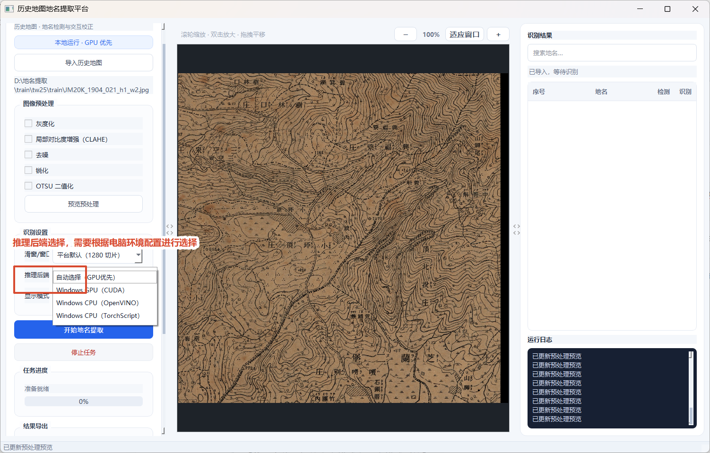

### 5. 显示模式

- **框外文字**：在绿色检测框附近显示识别出的地名和检测分数，适合检查识别结果。
- **干净模式（只显示框）**：只显示检测框，不在地图上覆盖文字，适合观察原始地图文字和漏检位置。

框外文字已经增加标签避让逻辑，但在极度密集区域仍可能需要缩放查看或切换干净模式。

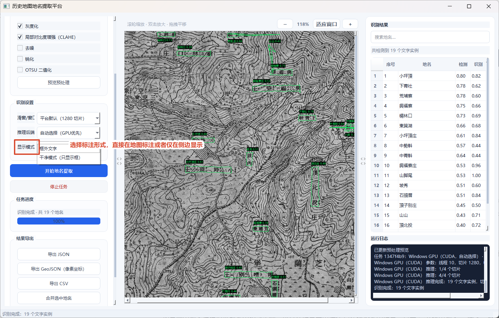
>
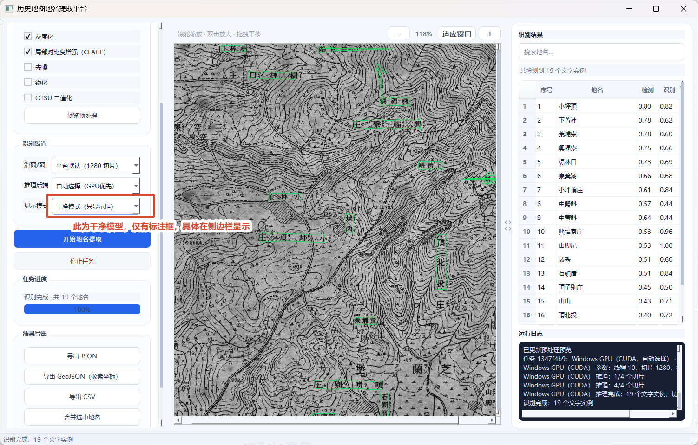

### 6. 开始地名提取与停止任务

点击“开始地名提取”后，平台会保存预处理图像、生成窗口、调用模型、恢复坐标、执行去重过滤，并在地图和结果表中显示结果。

点击“停止任务”后，平台会在当前窗口完成后停止。已经完成的部分不应直接作为完整结果使用，建议停止后重新开始一次完整推理。

### 7. 识别结果表

右侧结果表包含序号、地名、检测分数和识别分数。地名一列支持双击编辑；搜索框可以按文字筛选结果。点击地图上的绿色框或点击结果表中的一行，可以相互定位。

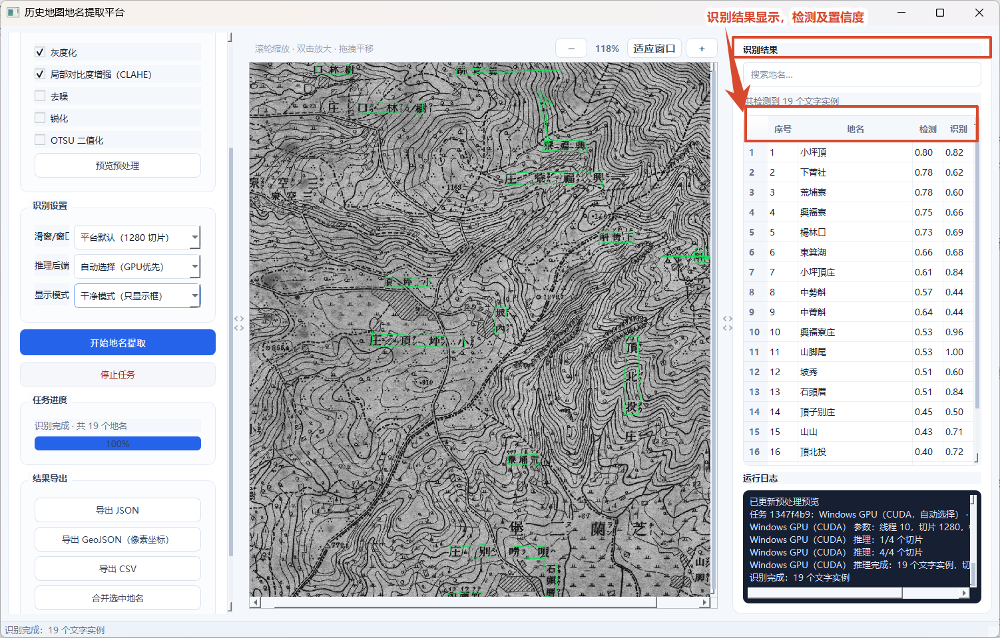

### 8. 合并选中地名

如果一个地名被模型拆成多个相邻实例，可以在结果表中按住 Ctrl 选择多个结果，点击“合并选中地名”，输入完整地名。

合并只修改当前任务结果，不会修改模型，也不会改变下一次推理结果。

### 9. 手动添加地名

对于完全漏检的文字，点击“手动添加地名”，在地图上拖拽框选文字区域，再输入地名。如果大面积漏检，应优先检查窗口尺寸、预处理和模型训练，而不是全部手工添加。

### 10. 结果导出

| 按钮 | 输出内容 | 适用场景 |
|---|---|---|
| 导出 JSON | 地名、分数、多边形和来源窗口 | 后续程序处理和实验记录 |
| 导出 GeoJSON（像素坐标） | 以 GeoJSON 保存检测多边形 | GIS 后续处理；当前不是经纬度 |
| 导出 CSV | 序号、地名和置信度 | Excel 统计、人工筛选 |
| 任务历史 | 加载以前的输入和结果 | 对比不同参数和后端 |

当前 GeoJSON 使用图像像素坐标。如果要在 QGIS 中显示真实地理位置，还需要地图配准、控制点和坐标系转换。

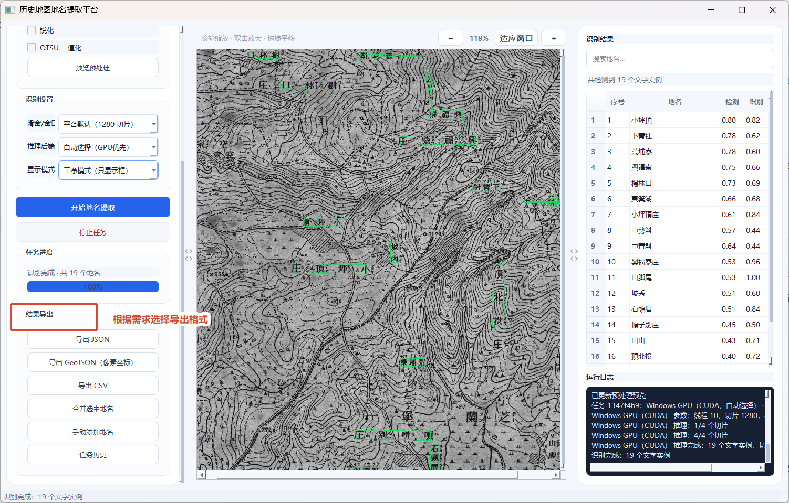

### 11. 模型文件的发布方式

模型文件不建议作为普通 Git 文件直接提交。当前三个主要模型单个约 170—180 MB，直接提交容易超过 GitHub 普通文件限制，也会让代码仓库变得很大。

推荐采用以下结构：

```text
GitHub 代码仓库
├─ app/
├─ scripts/
├─ models/model_manifest.json     # 模型版本、文件名和 SHA256
├─ models/tw25_cls_list.txt      # 小型词表，可随代码发布
└─ README.md

GitHub Release
├─ recognizer_cuda.ts             # GPU 模型
├─ recognizer.onnx                # OpenVINO 模型
├─ recognizer.ts                  # TorchScript CPU 模型
└─ tw25_cls_list.txt              # 与模型匹配的词表
```

首次发布时可以创建一个 Release，例如：

```text
v0.1.0-models
```

把模型文件作为 Release Assets 上传。用户下载后，将文件放入：

```text
historical_map_platform\models\
```

也可以使用项目提供的下载脚本。脚本会读取 `models/model_manifest.json`，下载对应文件，并自动检查文件大小和 SHA256：

```powershell
# 下载全部后端模型
.\scripts\download_models.ps1 -Backend all

# 只下载 CUDA 模型和共享词表
.\scripts\download_models.ps1 -Backend cuda

# 只下载 OpenVINO 模型和共享词表
.\scripts\download_models.ps1 -Backend openvino

# 模型版本变更后，确认清单后强制覆盖本地文件
.\scripts\download_models.ps1 -Backend all -Force
```

本仓库当前模型 Release 地址为：[v0.1.0-models](https://github.com/EveningFreeze/historical_map/releases/tag/v0.1.0-models)。如果将来更换模型，只需更新 `models/model_manifest.json` 中的版本、下载地址、文件大小和 SHA256。

模型迭代时不要直接覆盖旧文件，建议发布新的模型版本：

```text
v0.2.0-models
v0.3.0-models
```

每个模型版本应同时记录：

- 训练检查点或模型来源。
- 词表版本。
- 训练数据和验证集。
- 窗口尺寸、阈值和后处理参数。
- 文件大小和 SHA256。
- 当前模型的检测、识别和端到端指标。

这样可以保证用户能够复现实验，也可以在新模型效果变差时回退到旧版本。

如果希望用户只下载自己需要的模型，可以将 Release Assets 分为 CUDA、OpenVINO 和 TorchScript 三组；如果希望部署最简单，可以打包成一个完整的 `models-v0.1.0.zip`。对于普通用户，建议提供一个完整模型包；对于研究人员，再提供分后端模型包。

本项目统一使用 GitHub Release 分发模型，不要求普通用户安装 Git LFS。这样代码仓库保持较小，模型也可以独立更新和回退。

---

## 四、技术说明

### 1. 前端

- PyQt5：桌面窗口、按钮、下拉框、表格、进度条和任务交互。
- QGraphicsView：地图显示、缩放、拖拽、检测框和文字标签叠加。
- QThread：把推理任务放到后台线程，避免推理时窗口完全无响应。

### 2. 图像处理与后处理

- OpenCV：图像读取、缩放、灰度化、CLAHE、去噪、锐化和 OTSU 二值化。
- NumPy：图像数组和模型输出处理。
- Shapely：多边形几何处理和几何过滤。
- 多边形 NMS：减少重叠窗口产生的重复检测框。
- 坐标恢复：把窗口坐标转换回整幅地图坐标。
- 标签避让：在框外显示文字时，尽量避免标签相互覆盖。

### 3. 模型

平台模型基于 DeepSolo 的文字检测与识别结构，并针对 TW25 台湾地图数据进行了微调和繁体中文词表适配。部署时使用：

- `recognizer_cuda.ts`：Windows CUDA GPU 模式。
- `recognizer.onnx`：OpenVINO CPU 模式。
- `recognizer.ts`：TorchScript CPU 回退模式。
- `tw25_cls_list.txt`：繁体中文字符词表。

模型输出包括文字检测分数、字符类别序列、控制点和边界点。平台会经过字符解码、坐标恢复、重复框抑制和置信度过滤后再显示结果。

### 4. 数据保存

平台使用 SQLite 保存任务历史。每次任务通常会保存：

```text
data/tasks/<任务编号>/
├─ preprocessed.png
└─ predictions.json
```

结果 JSON 中主要包含：

```json
{
  "text": "识别出的地名",
  "score": 0.85,
  "rec_confidence": 0.72,
  "polygon": [[x1, y1], [x2, y2]],
  "source_tile": [x0, y0, x1, y1]
}
```

---

## 五、后续可以继续改进的方向

### 1. 针对地名密集区域继续微调

当前密集区域容易出现漏检、重复框和相邻文字被拆开的情况。后续可以专门收集城市周边、河流交汇处、图例附近和地名密集区域的数据，再对检测头和识别头进行针对性微调。

重点可以放在：

- 密集地名区域。
- 小字号文字。
- 低对比度和老化纸张。
- 竖排、倾斜和弯曲文字。
- 同一窗口中多个相邻地名。

### 2. 改进繁体字和异体字识别

可以继续使用繁体中文合成地图数据，统计新增字符覆盖率，并采用“识别头专项训练 → 全网络联合微调 → 真实地图专项微调”的方式，减少词表扩展后识别头不稳定的问题。

### 3. 自动组合地名

当前平台支持人工合并地名，但还没有完全自动判断哪些文字属于同一个地名。后续可以结合检测框距离、排列方向、字符置信度、历史地名词典和地图上下文，把被拆开的文字自动组合成候选地名，再交给用户确认。

### 4. 引入历史地名知识库

在文字识别之后，可以增加历史地名知识库，用于处理繁体字、异体字和旧称，并判断识别结果是否可能是真实地名。建议保留“模型原始结果—候选结果—人工确认结果”三层信息，不要直接覆盖原始识别文本。

### 5. 增加地名的时间和空间推断

可以根据地图标题、出版年代、行政区划和历史地名数据库，推测地名的历史时期和现代对应位置：

```text
模型识别结果 → 历史地名候选 → 地图年代匹配 → 现代地名候选 → 用户确认
```

这些推断应作为辅助信息展示，并给出可信度，不能在没有依据时直接替换模型结果。

### 6. 增加地图配准与 GIS 功能

当前 GeoJSON 仍然是图像像素坐标。后续可以增加控制点配准、地图投影和 CRS 设置，将地名框转换为真实经纬度，再输出给 QGIS 或其他 GIS 软件使用。

### 7. 改进平台功能

- 增加文件夹批量处理、任务队列和失败重试。
- 增加框分裂、框合并、框拖动和快捷键编辑。
- 自动标记低置信度、疑似重复和疑似拆分地名。
- 保存模型版本、词表版本、窗口参数和后端信息。
- 增加不同后端、窗口模式和阈值的实验对比页面。
- 最终封装成无需 Python 环境的 Windows 安装包。

---

## 六、常见问题

### Q1：必须安装 WSL 吗？

不需要。普通用户使用的是 Windows 原生 CUDA、OpenVINO 或 TorchScript 后端。WSL 只适合研究训练和模型导出，不属于平台使用前置条件。

### Q2：GPU 和 CPU 模式的准确率完全一样吗？

模型权重和后处理逻辑相同，但不同运行时的浮点计算可能产生轻微差异。正式报告中应固定后端并重新评测，不能直接假设两个后端的指标完全一致。

### Q3：为什么图片越大，切片数量越多？

切片数量由图片宽高、窗口尺寸和重叠率决定。图片越大，需要覆盖的区域越多；窗口越小或重叠率越高，切片数量通常也会增加。

### Q4：为什么检测框很多，但完整地名识别不准确？

检测只说明模型找到了疑似文字区域，完整识别还需要正确预测每个字符。当前 TW25 实验中检测 F1 明显高于端到端 F1，说明识别头、词表覆盖和地名组合仍是主要问题。

### Q5：模型文件放在哪里？

统一放在：

```text
historical_map_platform\models\
```

不要把模型放到 `.venv_gpu` 或 `.venv_cpu` 中，也不要修改模型文件名。

### Q6：结果为什么不是经纬度？

平台目前只知道文字在图片中的像素位置。要得到经纬度，还需要地图配准、控制点和坐标系信息，这属于后续 GIS 功能。

---

## 七、项目目录

```text
historical_map_platform/
├─ app/
│  ├─ main.py                  # 主界面和按钮逻辑
│  ├─ widgets.py               # 地图画布、检测框和文字标签
│  ├─ preprocessing.py         # 图像预处理
│  ├─ cuda_inference.py        # CUDA GPU 推理
│  ├─ openvino_inference.py    # OpenVINO CPU 推理
│  ├─ cpu_inference.py         # TorchScript CPU 推理
│  ├─ cpu_postprocess.py       # NMS、几何过滤和结果整理
│  ├─ worker.py                # 后台推理线程
│  └─ database.py              # SQLite 任务历史
├─ models/                     # 模型和繁体中文词表
│  ├─ model_manifest.json      # 模型下载清单和 SHA256
│  └─ tw25_cls_list.txt        # 繁体中文字符词表
├─ data/tasks/                 # 任务结果和历史记录
├─ scripts/                    # 安装、测试、转换和快捷方式脚本
├─ LICENSE                     # 源码许可证
├─ THIRD_PARTY_NOTICES.md      # 第三方代码、模型和数据说明
├─ requirements.txt            # 基础依赖
├─ requirements-gpu.txt        # GPU 依赖
├─ requirements-cpu.txt        # CPU 依赖
├─ run.py                      # 直接启动入口
├─ run_platform.ps1            # 自动选择环境的启动器
└─ README.md                   # 本说明文件
```

## 许可证与模型说明

### 源码许可证

本仓库中由项目维护者原创的源码和文档采用 [MIT License](LICENSE)。

### 模型、数据和第三方依赖

MIT License 不自动覆盖以下内容：

- DeepSolo、AdelaiDet、Detectron2 等上游项目代码及其许可证要求；
- `models/` 中的模型权重和字符词表；
- TW25、SynthMap+ 及其他训练数据；
- 用户导入的历史地图图像；
- PyQt5、PyTorch、OpenVINO、OpenCV、NumPy、Shapely 等第三方依赖。

这些内容的授权边界和发布注意事项见 [THIRD_PARTY_NOTICES.md](THIRD_PARTY_NOTICES.md)。发布模型 Release 前，应补充模型来源、训练数据授权、是否允许商业使用以及对应 SHA256。未经确认，不要把模型权重或历史地图数据宣传为 MIT 开源内容。
